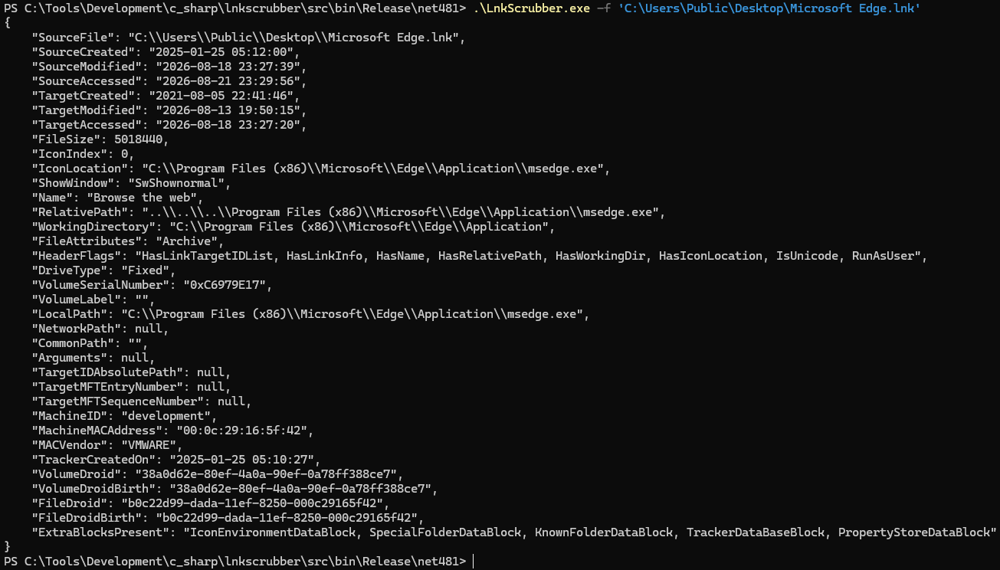
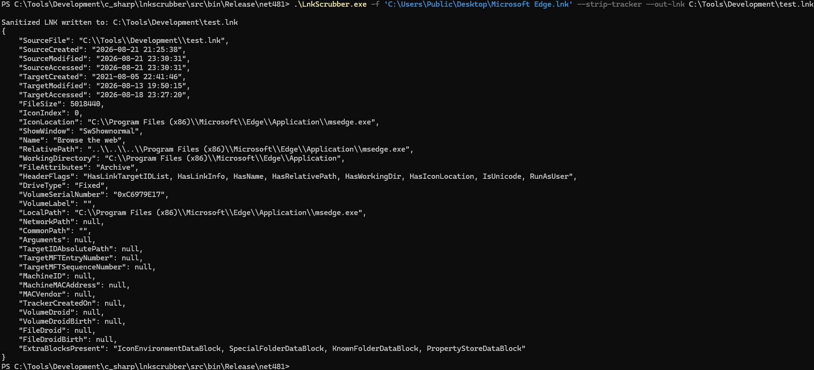

# LnkScrubber

A C# command-line tool to parse and sanitize Windows `.lnk` shortcut file metadata. Extracts forensic fields (TrackerDataBaseBlock, MachineID, MAC address, droid GUIDs, timestamps) and provides options to strip, anonymize, or manually edit tracker data before sharing.

## Before


## After


## Features
- Parse a `.lnk` file and emit prettified JSON to stdout.
- Extracts header, link info, string data, icon info, show window, and extra data block names.
- TrackerDataBaseBlock support: MachineID, MAC with OUI vendor lookup, creation time, droid GUIDs.
- MAC vendor database (`Resources/MACs.txt`) is embedded into the executable at build time — no external files needed.
- Sanitization options:
  - `--strip-tracker` — remove the tracker block entirely.
  - `--anonymize` — replace tracker block with randomized MachineID/MAC/droids and creation time.
  - `--manualedit` — interactively set MachineID, MAC, and creation time.
- `--out-lnk` writes a modified copy when sanitizing; otherwise the original is left untouched.

## Requirements
- .NET Framework 4.8.1 
- Visual Studio 2022 or .NET SDK to build

## Build
Open `LnkScrubber.sln` in Visual Studio and build, or from the command line:
```bash
cd src
dotnet build -c Release
```

Output: `src/bin/Release/net481/LnkScrubber.exe`

## Usage
```
LnkScrubber -f <file> [options]

Options:
  -f, --file <path>        Path to the .lnk file to parse
  --strip-tracker          Remove the TrackerDataBaseBlock entirely
  --anonymize              Replace tracker with randomized MachineID/MAC/droids
  --manualedit             Interactively edit tracker fields
  --out-lnk <path>         Output path for modified LNK (default: <stem>_sanitized.lnk)
  --dt "format"            DateTime format string (default: yyyy-MM-dd HH:mm:ss)
  -h, --help               Show help
```

### Examples
```bash
# Parse and print JSON to stdout
LnkScrubber -f C:\path\file.lnk

# Strip tracker data
LnkScrubber -f C:\path\file.lnk --strip-tracker --out-lnk C:\path\file_clean.lnk

# Anonymize tracker data (random MachineID/MAC/creation/date/time)
LnkScrubber -f C:\path\file.lnk --anonymize --dt "1900-01-01 12:12:12" --out-lnk C:\path\file_anon.lnk

# Manually edit tracker fields
LnkScrubber -f C:\path\file.lnk --manualedit --out-lnk C:\path\file_custom.lnk
```

## Acknowledgments
- Parsing logic inspired by Eric Zimmerman's [LECmd](https://github.com/ericzimmerman/lecmd), a full-featured LNK forensic parser.
